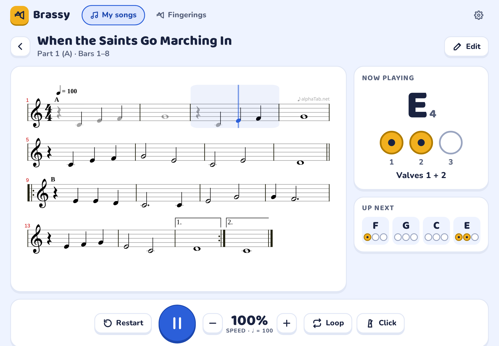
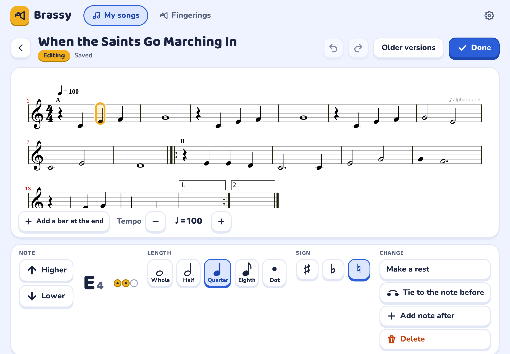

# Brassy

**Try it: [brassy.vercel.app](https://brassy.vercel.app)**

A friendly app for practising and editing **B♭ trumpet** music, made for a 9–12-year-old beginner. It shows the
music, plays it with a trumpet sound, highlights the note being played, shows which valves to press, loops tricky
bars and slowly speeds them up, and lets you fix or write songs.

Brassy is made for a **tablet** with a 10" screen, held sideways: mainly **Android** tablets, and iPads too. It also
works on a computer, and on a phone in a smaller layout.

There are no accounts and no ads. Brassy works offline once installed and keeps everything on the device. A grown-up
can turn on a backup to their **Google Drive**, and Brassy can only see its own backup file there.

## On an Android tablet

Open [brassy.vercel.app](https://brassy.vercel.app) in **Chrome** → menu (⋮) → **Add to Home screen** → *Install*
(Chrome may also offer *Install app* by itself). Use Brassy from its icon: it opens full screen, works offline, and
Chrome keeps its data more reliably than for an ordinary website. The installed app and Chrome share the same data,
so songs and the Google Drive connection carry over. When a new version comes out, a *New version — update* button
appears in the top bar.

Clearing Chrome's data for the site deletes Brassy's songs on the tablet, so turn on the Drive
backup or export a backup file now and then (see below).

## On the iPad

Open [brassy.vercel.app](https://brassy.vercel.app) in Safari → Share → **Add to Home Screen**. Use Brassy from the
Home Screen icon: it then works offline, and iPadOS keeps its data more reliably than in a Safari tab. Note that the
Home Screen app and Safari keep **separate** data, so connect Google Drive from inside the Home Screen app. When a
new version comes out, a *New version — update* button appears in the top bar.

## Google Drive backup

A grown-up opens **Settings** (gear icon, hold the button for 2 seconds) and taps *Connect Google Drive*. Brassy
then backs up a few seconds after every change, to one file called `Brassy backup.json`. Google sign-ins last about
an hour; after that a small *Tap to back up* button appears when there are unsaved changes. On a new tablet, connect
the same account and the songs come back. If both the tablet and Drive changed, Brassy asks a grown-up: *Combine
both*, *Use the Drive copy* or *Keep this tablet's copy*.

## Languages and note names

Brassy speaks **English**, **Italian** and **German**. It follows the device language; a grown-up can change it in
*Settings → Language*. **Note names** are a separate choice, so the app can be in Italian while the notes use the
names the child learns at lessons:

| Setting | Example |
|---|---|
| Same as the language | Do Re Mi in Italian, C D E … H in German, C D E in English |
| C D E F G A B | B♭, F♯ |
| C D E F G A H (German) | B = B♭, H = B, Fis, Es |
| Do Re Mi Fa Sol La Si | Si♭, Fa♯ |

Both choices are stored on the device only (they are not part of backups).

## Tempo

The player's speed (25–150%) changes how fast the song plays; the tempo it plays at is shown under the percentage
(e.g. `110% · ♩ = 110`). To change the song's own tempo, open the editor and use **Tempo − / +** (30–240 bpm).

## Playing along without sound

Tap **Trumpet** in the player to turn the trumpet sound off: the music still scrolls and each note lights up in
time, so the child plays it alone. Turn on **Click** too for a metronome that keeps the pace.

## Keeping songs safe

- Everything is stored on the device; Brassy asks the browser to keep it (*Settings → Storage*).
- *Settings → Backup file*: export everything as one `.json` file, or import one (add to the tablet, or replace).
- The editor saves automatically and keeps the last 20 versions of each song (*Older versions*).
- Only one tab or window can save at a time; an older tab shows a banner and stops saving.

## Licence

Copyright © 2026 the Brassy authors.

Brassy is free software: you can redistribute it and/or modify it under the terms of the **GNU Affero General
Public License** as published by the Free Software Foundation, either version 3 of the License, or (at your option)
any later version. See [LICENSE](LICENSE). *About Brassy* in the app links to the licence and the source code.

Third-party parts keep their own licences, all compatible with the AGPL: alphaTab (MPL-2.0, whose "♪ alphaTab.net"
attribution must stay visible in the rendered score), the Bravura music font, Baloo 2 and Nunito (SIL OFL 1.1),
the Sonivox SoundFont (Apache-2.0), and React, idb and Workbox (MIT/ISC). *When the Saints Go Marching In* is a
traditional public-domain melody; the beginner arrangement is part of Brassy.

Want to run, change or host your own copy? See [DEVELOPMENT.md](DEVELOPMENT.md).
